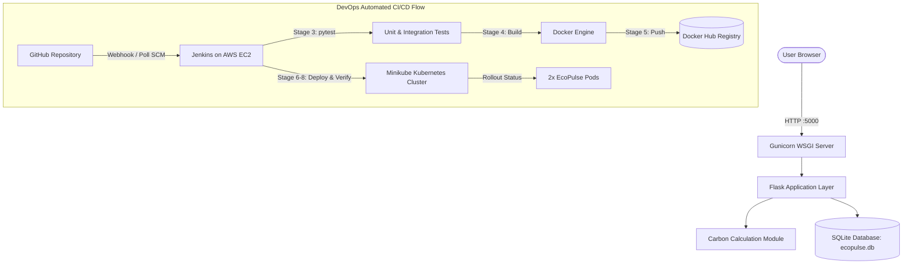

# EcoPulse: Smart Sustainability Tracker
> **Cloud Computing & DevOps Assignment (CCA 2) Project**  
> *A full-stack, lightweight carbon footprint tracking web application with automated CI/CD deployment via GitHub, Jenkins, Docker, Docker Hub, AWS EC2, and Kubernetes on Minikube.*

---

## 1. Project Overview

### What is EcoPulse?
**EcoPulse** is an intuitive, high-precision personal sustainability tracker and carbon footprint accounting dashboard. It allows users to record, evaluate, and monitor greenhouse gas emissions generated across four core lifestyle dimensions:
1. **Transportation:** Personal vehicle mileage, fuel economy (MPG), maintenance efficiency factor, public transit, and commercial flights.
2. **Home Energy:** Monthly electricity consumption (kWh), clean/renewable energy percentage, and home heating usage.
3. **Waste Management:** Municipal solid waste volume, household recycling rigor, and organic composting diversion.
4. **Lifestyle & Consumer Habits:** Dietary patterns (plant-based through meat-heavy), consumer shopping frequency, and reusable habit consistency.

### Why is it useful?
Most carbon calculators are either overly simplistic static forms or require expensive third-party APIs. EcoPulse uses documented, scientific baseline emission factors (derived from EPA, DEFRA, and ICAO datasets), operates completely offline without external paid services, persists entries in a local SQLite database, and computes immediate comparisons against global (4.0 t/yr) and US (16.0 t/yr) baselines.

---

## 2. Technology Stack

| Layer | Technology | Purpose |
| :--- | :--- | :--- |
| **Backend** | Python 3.11+ / Flask 3.1 | REST API, route controllers, session handling |
| **Calculation Engine** | Python (`calculations.py`) | Transparent mathematical conversion to kg CO<sub>2</sub>e and metric tonnes |
| **Frontend** | Vanilla HTML5, CSS3, JavaScript | High-fidelity dark charcoal dashboard, reactive controls |
| **Templating** | Jinja2 | Dynamic server-side page rendering (`base.html`, `index.html`, `about.html`) |
| **Visualizations** | HTML5 Canvas (3D & 2D) | Faceted low-poly 3D rotating Earth globe & interactive history line chart |
| **Storage** | SQLite (`ecopulse.db`) | Thread-safe, zero-dependency persistent storage |
| **Production Server** | Gunicorn WSGI | Production-grade multi-worker WSGI container server |
| **Containerization** | Docker | Non-root, lightweight container packaging |
| **CI/CD Automation** | Jenkins Declarative Pipeline | Multi-stage build, test, package, push, and deploy pipeline |
| **Container Registry** | Docker Hub | Public/private image repository |
| **Orchestration** | Kubernetes on Minikube | Declarative Deployment and NodePort Service with health probes |
| **Cloud Host** | AWS EC2 (Ubuntu Linux) | Cloud host for Jenkins automation server |

---

## 3. Architecture & Request Flow



---

## 4. Project Directory Structure

```text
EcoPulse/
├── app.py                      # Flask application factory and route controllers
├── config.py                   # App configuration and documented emission constants
├── calculations.py             # Scientific carbon calculation and recommendation heuristics
├── database.py                 # SQLite database helper routines and migrations
├── requirements.txt            # Production dependencies (Flask, Gunicorn)
├── requirements-dev.txt        # Development dependencies (pytest, pytest-asyncio)
├── Dockerfile                  # Secure, non-root Docker build instructions
├── .dockerignore               # Files excluded from the Docker image context
├── .gitignore                  # Git untracked files (venv, database, pycache)
├── .env.example                # Template of required environment variables
├── Jenkinsfile                 # Declarative 8-stage CI/CD pipeline
├── pytest.ini                  # Pytest test suite configuration
├── README.md                   # Complete architectural, setup, and viva guide
├── tests/
│   ├── test_app.py             # Integration tests for routes, CRUD, and /healthz
│   └── test_calculations.py    # Unit tests for calculation math and inputs
├── templates/
│   ├── base.html               # Base layout with navigation and theme switch
│   ├── index.html              # Main dashboard (Earth View, Breakdown, Metrics)
│   └── about.html              # Architecture, emission factors, and endpoints
└── static/
    ├── css/
    │   └── style.css           # Premium dark charcoal & emerald design system
    └── js/
        └── dashboard.js        # 3D Canvas Earth, history chart, and CRUD state
k8s/
├── deployment.yaml             # Kubernetes Deployment (2 replicas, non-root, probes)
└── service.yaml                # Kubernetes NodePort Service (Port 30080)
```

---

## 5. Local Setup & Execution Guide

### Prerequisites
- Python 3.10+ (Tested on Python 3.11, 3.12, 3.14)
- Git

### Installation Commands

#### On Windows (PowerShell):
```powershell
# 1. Clone or navigate to the project directory
cd c:\Users\Shashwat\OneDrive\Documents\3.Projects\EcoPulse

# 2. Create a virtual environment
python -m venv venv

# 3. Activate the virtual environment
.\venv\Scripts\Activate.ps1

# 4. Upgrade pip and install dependencies
python -m pip install --upgrade pip
pip install -r requirements-dev.txt

# 5. Run the automated test suite
python -m pytest

# 6. Start the local development server
python app.py
```

#### On Windows (Command Prompt `cmd.exe`):
```cmd
cd c:\Users\Shashwat\OneDrive\Documents\3.Projects\EcoPulse
python -m venv venv
venv\Scripts\activate.bat
python -m pip install --upgrade pip
pip install -r requirements-dev.txt
python -m pytest
python app.py
```

#### On Linux / macOS:
```bash
cd EcoPulse
python3 -m venv venv
source venv/bin/activate
pip install --upgrade pip
pip install -r requirements-dev.txt
pytest
python3 app.py
```

Open your browser to: **`http://localhost:5000`**

---

## 6. Running Automated Tests

EcoPulse includes comprehensive automated tests covering:
- Route response codes (200, 201, 400, 404).
- Health probe validation (`/healthz`).
- Exact mathematical conversion from consumer units to kg CO<sub>2</sub>e and metric tonnes.
- Input validation (rejecting negative numbers, string payloads, and out-of-range bounds).
- Full CRUD database persistence.

To execute the tests:
```bash
python -m pytest -v
```
All 13 unit and integration tests should pass with 0 errors.

---

## 7. Containerization with Docker

### Build the Docker Image
```bash
docker build -t your-dockerhub-username/ecopulse:latest .
```

### Run the Container Locally
```bash
docker run -d \
  --name ecopulse-app \
  -p 5000:5000 \
  -e PORT=5000 \
  your-dockerhub-username/ecopulse:latest
```

### Verify Container Health
```bash
# Check running status
docker ps

# Verify the health-check endpoint
curl -i http://localhost:5000/healthz
```

### Push to Docker Hub
```bash
# Login to Docker Hub
docker login

# Push the tagged image
docker push your-dockerhub-username/ecopulse:latest
```

---

## 8. CI/CD Setup: Jenkins on AWS EC2 to Minikube

### Architecture Explanation (Key for Viva)
In this assignment:
1. **Jenkins** runs on an **AWS EC2 Ubuntu Instance** (t2.medium or t3.medium recommended).
2. **Minikube** runs the Kubernetes target cluster.

#### How does AWS Jenkins reach Minikube?
There are two standard, accepted architectures:
- **Approach A (Single Host / Simplest):** Both Jenkins and Minikube run on the same AWS EC2 instance (`t3.large` or `t3.xlarge`). Jenkins executes `kubectl` natively with zero network latency.
- **Approach B (Hybrid: Jenkins on AWS EC2, Minikube on Local Machine):**
  - Install the **Jenkins Inbound Agent** on your local machine where Minikube runs.
  - The local agent initiates an outbound connection to Jenkins on AWS over port 50000.
  - The pipeline runs the deployment stage on the local agent (`agent { label 'minikube-node' }`), giving it direct access to Minikube without opening inbound firewall ports on your personal home router.

---

### Step-by-Step Jenkins Configuration

#### 1. Launch AWS EC2 Instance
- OS: Ubuntu 22.04 LTS
- Instance type: `t2.medium` (minimum 2 vCPUs, 4GB RAM)
- Security Group Inbound Rules:
  - Port `22` (SSH) — Your IP
  - Port `8080` (Jenkins Web UI) — Your IP
  - Port `50000` (Jenkins Agent Port) — If using hybrid agent

#### 2. Install Tools on the AWS EC2 Instance
```bash
# Update packages
sudo apt update && sudo apt upgrade -y

# Install OpenJDK 17
sudo apt install -y openjdk-17-jdk git curl

# Install Docker
sudo apt install -y docker.io
sudo systemctl enable --now docker
sudo usermod -aG docker ubuntu
sudo usermod -aG docker jenkins # (after jenkins is installed)

# Install Jenkins
curl -fsSL https://pkg.jenkins.io/debian-stable/jenkins.io-2023.key | sudo tee \
  /usr/share/keyrings/jenkins-keyring.asc > /dev/null
echo deb [signed-by=/usr/share/keyrings/jenkins-keyring.asc] \
  https://pkg.jenkins.io/debian-stable binary/ | sudo tee \
  /etc/apt/sources.list.d/jenkins.list > /dev/null
sudo apt update
sudo apt install -y jenkins
sudo systemctl enable --now jenkins

# Install kubectl
curl -LO "https://dl.k8s.io/release/$(curl -L -s https://dl.k8s.io/release/stable.txt)/bin/linux/amd64/kubectl"
sudo install -o root -g root -m 0755 kubectl /usr/local/bin/kubectl
```

#### 3. Required Jenkins Plugins
In **Manage Jenkins > Plugins > Available plugins**, install:
- **Pipeline**
- **Git**
- **Credentials Binding Plugin**
- **JUnit Plugin**

#### 4. Configure Jenkins Credentials
Navigate to **Manage Jenkins > Credentials > System > Global credentials**:
1. **Docker Hub Credentials:**
   - Kind: `Username with password`
   - Scope: `Global`
   - ID: `dockerhub-credentials`
   - Username: `<your-dockerhub-username>`
   - Password: `<your-dockerhub-access-token>`
2. **Minikube Kubeconfig (if connecting remotely):**
   - Kind: `Secret file`
   - Scope: `Global`
   - ID: `minikube-kubeconfig`
   - File: Upload your `~/.kube/config` file.

#### 5. Create the Jenkins Pipeline Job
1. Click **New Item** > Enter `EcoPulse-Pipeline` > Select **Pipeline** > Click **OK**.
2. Under **Pipeline**:
   - Definition: `Pipeline script from SCM`
   - SCM: `Git`
   - Repository URL: `https://github.com/Shashwat2506/EcoPulse.git`
   - Branches to build: `*/main`
   - Script Path: `Jenkinsfile`
3. Click **Save** and trigger **Build with Parameters**.

---

## 9. Kubernetes Deployment on Minikube

### 1. Start Minikube
```bash
minikube start --driver=docker
```

### 2. Apply Manifests Manually (Verification)
```bash
kubectl apply -f k8s/deployment.yaml
kubectl apply -f k8s/service.yaml
```

### 3. Verify Rollout & Pods
```bash
# Check rollout status
kubectl rollout status deployment/ecopulse-deployment

# Check pod state
kubectl get pods -l app=ecopulse

# Check service NodePort
kubectl get svc ecopulse-service
```

### 4. Access the Application in Minikube
```bash
# Option A: Get direct browser URL from Minikube
minikube service ecopulse-service --url

# Option B: Port-forward to localhost:5000
kubectl port-forward svc/ecopulse-service 5000:5000
```
Open **`http://localhost:5000`** in your browser.

---

## 10. Demonstrating a Code Change (Second Deployment)

To demonstrate automated CI/CD for your instructor:
1. Open `templates/base.html` or `config.py`.
2. Make a small visible change (e.g. adjust brand tag or benchmark text).
3. Commit and push to GitHub:
   ```bash
   git add .
   git commit -m "feat: updated brand tagline for viva demo"
   git push origin main
   ```
4. In Jenkins, watch the pipeline trigger automatically:
   - Automated tests run and pass.
   - New Docker image built with incremental tag (e.g., `:2`).
   - Image pushed to Docker Hub.
   - Kubernetes executes a rolling update without downtime (`kubectl rollout status`).
5. Refresh the Minikube app URL to show the updated version live.

---

## 11. Security & AWS Cost Considerations

### Security Best Practices Implemented
- **No Hard-coded Secrets:** All credentials, keys, and tokens are stored in Jenkins Credential Store and `.env`.
- **Non-Root Container:** Docker container runs as unprivileged user `ecopulse` (UID `10001`).
- **Resource Constraints:** Kubernetes manifests define CPU and memory limits to prevent runaway containers.
- **Liveness & Readiness Probes:** Container traffic is only routed after `/healthz` returns HTTP 200.

### AWS Free Tier & Cost Controls
- AWS EC2 `t2.micro` is Free Tier eligible (750 hours/month for 12 months).
- If using `t2.medium` / `t3.medium` for Jenkins:
  - **Always Stop the EC2 instance** when not actively testing or presenting:
    ```bash
    aws ec2 stop-instances --instance-ids i-xxxxxxxxxxxxxxxxx
    ```
  - Disassociate unused Elastic IPs to prevent idle hourly charges.
  - Terminate the instance after final evaluation.

---

## 12. CCA 2 Demonstration Checklist

Use this checklist during your assignment demonstration:

- [ ] **Repository Structure:** Clean root directory with `app.py`, `calculations.py`, `Dockerfile`, `Jenkinsfile`, and `k8s/`.
- [ ] **Automated Testing:** Run `pytest` and demonstrate 13 passing tests.
- [ ] **Local Execution:** Run `python app.py` and show the 3D Earth, breakdown bars, and metrics panel.
- [ ] **Data Persistence:** Create a log, refresh the page, and show the persisted log entry in SQLite.
- [ ] **Recommendations (Echo ✨):** Toggle the pill button to show tailored carbon reduction advice.
- [ ] **Docker Build:** Show `docker build` creating a non-root image.
- [ ] **Jenkins Pipeline:** Show all 8 stages green in the Jenkins stage view.
- [ ] **Docker Hub:** Show the published tagged images in your Docker Hub repository.
- [ ] **Minikube Deployment:** Run `kubectl get pods,svc` and show 2 healthy running replicas.
- [ ] **Health Probe:** Demonstrate `curl http://<pod-ip>:5000/healthz` returning status 200.

---

## 13. Student Viva Questions & Correct Answers

### Q1: Why did you separate `calculations.py` from Flask route handlers?
> **Answer:** To adhere to the Single Responsibility Principle and Separation of Concerns. Isolating calculation logic enables deterministic unit testing with `pytest` without spinning up HTTP test clients or database connections.

### Q2: What is the purpose of the `/healthz` endpoint?
> **Answer:** `/healthz` serves as the liveness and readiness probe for Kubernetes and Docker. Kubernetes queries this endpoint periodically to verify that the WSGI worker is responsive and the SQLite database is accessible. If it fails, Kubernetes automatically restarts the pod.

### Q3: Why does the Dockerfile create an `ecopulse` user with UID 10001?
> **Answer:** Running containers as root introduces severe security vulnerabilities. If an attacker breaches the application, they would gain root privileges on the container and potentially escape to the host. A dedicated non-root user enforces the principle of least privilege.

### Q4: How does rolling update work in your `deployment.yaml`?
> **Answer:** `maxSurge: 1` and `maxUnavailable: 0` ensure zero downtime. Kubernetes starts one new pod with the new container image, waits for its readiness probe (`/healthz`) to succeed, and only then terminates the old pod.

### Q5: How does Jenkins on AWS communicate with Minikube?
> **Answer:** Minikube is designed for local single-node clusters. If Jenkins is on AWS and Minikube is local, Jenkins can deploy via a Jenkins Inbound Agent running on the local host, or by hosting Minikube on the same AWS EC2 instance as Jenkins. The `KUBECONFIG` credential securely supplies the cluster endpoint and client certificates.

### Q6: Why is SQLite suitable for this containerized project?
> **Answer:** SQLite is serverless, zero-configuration, and stores data in a single file (`ecopulse.db`). It eliminates the operational overhead of running a separate database server (like PostgreSQL or MySQL), minimizing AWS resource costs while providing ACID-compliant persistence.
